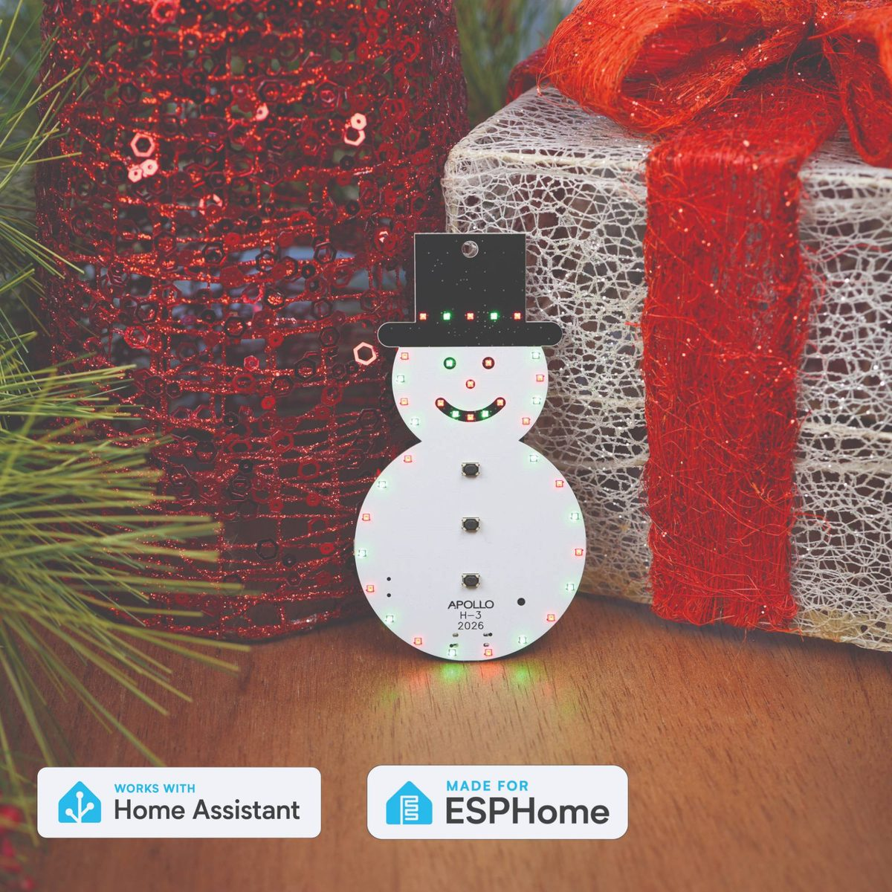

# Apollo H-3 Holiday Ornament

  

The H-3 is Apollo Automation's 2026 holiday ornament, the third in our annual charity series. It is a snowman with 37 RGB LEDs, a buzzer and six holiday songs. Press a button and it plays a song with its own light show, with no setup. The H-3 is Made for ESPHome and certified Works with Home Assistant, so you can also install the Smart firmware and control it from Home Assistant.

**100% of the profits from the H-3 go to [St. Jude Children's Research Hospital](https://www.stjude.org/) this year (2026).**

## Key features

- **37 RGB LEDs in five zones** you can control separately: body (24), hat (5), mouth (5), eyes (2) and nose (1)
- **Six holiday songs on three buttons**, played on the buzzer, each with its own light effect
- **Two AA batteries or USB-C**, with deep sleep between songs to save the batteries
- **Ready to play out of the box** with the Basic firmware. No Wi-Fi or app needed.
- **Smart firmware for Home Assistant:** change the songs, light effects and volume, run automations, use it as a Bluetooth proxy and get firmware updates over the air
- **[Works with Home Assistant](https://works-with.home-assistant.io/):** certified by the Open Home Foundation
- **[Made for ESPHome](https://devices.esphome.io/devices/Apollo_Automation_H-3/):** the configuration is public, and you can take control of it in the ESPHome Device Builder
- ESP32-C6 with 8 MB flash

## Songs and buttons

The three buttons on the front of the snowman play the songs. Press a button for its first song, or hold it for about a second for its second song. While the ornament is awake, a double-click also plays the second song, and pressing a button during a song switches to the new song.

| Button | Press | Hold (or double-click) |
| --- | --- | --- |
| 1 | Frosty the Snowman, with a rainbow wave | Blue Christmas, with twinkling blues |
| 2 | Rudolph the Red-Nosed Reindeer, twinkling white with a red nose | Do You Want to Build a Snowman, with falling snow |
| 3 | Jingle Bells, in red and green | Barbie Girl, in pink |

Hold buttons 1 and 3 together for a seventh song, the Imperial March, with the whole snowman pulsing red on the beat. This also works to wake the ornament: press both and keep holding them for about half a second.

On the Smart firmware each song is a **Song Text** entity in Home Assistant that holds an RTTTL string, so you can swap in any tune (see the [holiday songs list](https://wiki.apolloautomation.com/products/h3/examples/holiday-songs/)). **Volume** sets how loud the buzzer plays. A factory reset brings back the original seven songs.

## LED zones

| Zone | LEDs | Home Assistant entity |
| --- | --- | --- |
| Body | 24 | Body Light |
| Hat | 5 | Hat Light |
| Mouth | 5 | Mouth Light |
| Eyes | 2 | Eyes Light |
| Nose | 1 | Nose Light |
| Whole ornament | 37 | All Lights |

On the Smart firmware each zone has its own color, brightness and effect. There are 12 effects, including Slow Pulse, Fast Pulse and the effect from each song. **All Lights** drives all 37 LEDs as one strip, so it paints over whatever the zones are showing.

**Brightness limit:** by default the LEDs never go above 40% brightness, the same limit as the H-2. Every light's brightness, including 100% in Home Assistant, is scaled to that limit, and colors stay the same. The Basic firmware always uses 40%. On the Smart firmware the **LED Brightness** slider moves the limit anywhere from 25% to 100%.

## Power and sleep

The H-3 runs on two AA batteries or from its USB-C port. We suggest non-rechargeable AAs.

- **Basic firmware:** the ornament sleeps whenever it is not playing a song. Press a song button to wake it. It plays that song and goes back to sleep when the song ends. After you put the batteries in or plug in USB-C, it stays awake for about 15 seconds, then sleeps.
- **Smart firmware:** it stays awake by default so Home Assistant can reach it. To make the batteries last, turn off **Prevent Sleep** in Home Assistant (see [Use it with Home Assistant](#use-it-with-home-assistant)) or press the boot button three times quickly (see [Boot button](#boot-button)).

**First start:** after a fresh install or a factory reset, all 37 LEDs light green for about 5 seconds, then turn off on their own. That green means the firmware started and every LED works. You don't need to press anything. A button press during those 5 seconds ends the green early and does not play a song. On the Smart firmware the hat then blinks blue until the ornament is connected to Wi-Fi.

## Firmware

The H-3 has two ESPHome firmwares. Install either one at any time from the browser installer at [apolloautomation.github.io/H-3](https://apolloautomation.github.io/H-3/) (Chrome or Edge on a computer).

| | Basic (No Wi-Fi) | Smart (Wi-Fi) |
| --- | --- | --- |
| Installed at the factory | Yes | No, install it from the browser installer |
| Songs and lights from the buttons | Yes | Yes |
| Home Assistant | No | Yes, over Wi-Fi |
| Change songs, light effects and volume | No | Yes |
| LED brightness limit | 40% | 40% by default, 25% to 100% with the LED Brightness slider |
| Bluetooth proxy | No | Yes, off by default |
| Firmware updates | Reinstall from the browser installer | Over the air, Stable or Beta channel |
| Sleep | Sleeps between songs | Stays awake until you turn off Prevent Sleep |
| ESPHome configuration | `H-3D.yaml` | `H-3.yaml` |

### Install the Smart firmware

1. Take the batteries out. Hold the boot button on the back of the ornament, plug in a USB-C data cable, then let go of the button ([boot mode guide](https://wiki.apolloautomation.com/products/h3/troubleshooting/boot-mode/)).
2. In the installer, click **Connect** under **H-3 Smart (Wi-Fi) Firmware**, pick the ornament's serial port and install it.
3. When the install finishes, unplug the cable and plug it back in so the ornament restarts normally. After a fresh install, all the LEDs light green for about 5 seconds, then turn off.
4. Connect the ornament to Wi-Fi. Until it is connected, the hat blinks blue to show it is ready to set up. Use one of these ways:
   - Click **Connect** in the installer again and enter your Wi-Fi details.
   - Join the `Apollo H3 Hotspot` Wi-Fi network from a phone and choose your network.
   - Set it up from Home Assistant over Bluetooth with [Improv via BLE](https://www.home-assistant.io/integrations/improv_ble/).
5. Home Assistant discovers the ornament. Add it under **Settings > Devices & services**.

### Use it with Home Assistant

The Smart firmware is certified Works with Home Assistant. It talks to Home Assistant locally through the ESPHome integration; the only thing it fetches from the internet is the firmware update check.

- **Controls:** the five zone lights and **All Lights**, **Play Song 1** to **Play Song 7**, **Song Text 1** to **Song Text 7**, **Volume**, **LED Brightness**, **Prevent Sleep**, **Sleep Duration** and **Bluetooth Proxy**. Automations can also call the ornament's ESPHome actions: `play_song_1` to `play_song_7`, and `play_buzzer`, which plays any RTTTL string you pass it. **Song Button 1** to **Song Button 3** show button presses, and **Wake-up Button Pressed** shows which button last woke it.
- **Updates:** the ornament checks for new firmware soon after it starts and every 6 hours after that, and offers it through its **Firmware Update** entity. With **Prevent Sleep** off, it only checks for and installs updates while it is awake, so keep it awake for an update (see **Battery**). **Firmware Channel** switches between Stable and Beta.
- **Battery:** the Smart firmware stays awake by default. Turn off **Prevent Sleep** to let it sleep between button presses; press a song button to wake it. Three quick presses of the boot button also switch Prevent Sleep on or off (see [Boot button](#boot-button)). It also wakes on its own every **Sleep Duration** hours (24 by default) to check in with Home Assistant. To keep it awake for an update, create a toggle helper with the entity ID `input_boolean.apollo_ota_mode`, turn it on, then press a song button. The ornament sees the helper once it wakes and connects to Home Assistant. Turn the helper off after the update so it can sleep again.
- **New Wi-Fi network:** with Prevent Sleep off, the ornament goes back to sleep before its hotspot starts. Wake it with a song button, then hold the boot button for 3 to 10 seconds and let go before the song ends. That turns Prevent Sleep on, and about 90 seconds after the wake the `Apollo H3 Hotspot` network and Improv via BLE become available. Turn Prevent Sleep off again once it is back online.
- **Remove it:** delete the device under **Settings > Devices & services > ESPHome** while the ornament is awake. Factory reset it before you add it to a different Home Assistant.

### Boot button

The boot button is on the back of the ornament. It does not wake the ornament. If it is asleep, wake it with a song button, then use the boot button before the song ends. Short presses in the first 2 seconds after a wake are ignored.

- **Short press:** the body LEDs show the connection status for 5 seconds. Blue means connected to Home Assistant, green means Wi-Fi only and yellow means no Wi-Fi. On the Basic firmware they always show green. Then all 37 LEDs light green for 5 seconds as a light test. On the Smart firmware this starts about a second after you let go, in case more presses follow.
- **Three quick presses (Smart firmware only):** switches **Prevent Sleep** on or off, without Home Assistant. The whole ornament shows the new setting:
  - **White for 3 seconds:** Prevent Sleep is on, so the ornament stays awake.
  - **Purple, fading out:** Prevent Sleep is off, so the ornament can sleep. It goes to sleep about 90 seconds later, or as soon as a song ends.

  Any song that is playing stops. On the Basic firmware three presses run the status and light test, as one press does.
- **Hold for 3 to 10 seconds:** turns on **Prevent Sleep**, so the ornament stays awake.
- **Hold for 10 seconds or more, then release:** factory reset. This erases the Wi-Fi details and every saved setting (custom songs, volume, sleep and channel settings), then restarts. The **Factory Reset** button in Home Assistant does the same; it is in the Diagnostic section and disabled by default.

### ESPHome configuration

The H-3 is [Made for ESPHome](https://devices.esphome.io/devices/Apollo_Automation_H-3/). It runs ESPHome, its configuration is public, and you can take control of it and build your own firmware. The configuration lives in [Integrations/ESPHome](Integrations/ESPHome/) and is yours to modify:

- `H-3.yaml` is the Smart (Wi-Fi) firmware.
- `H-3D.yaml` is the Basic (No Wi-Fi) firmware.
- `Core.yaml` is shared by both: lights, songs, buttons and sleep.

To build your own firmware, use **Take Control** on the discovered ornament in the ESPHome Device Builder. It imports `H-3.yaml` automatically.

## Links

Discord (Support/feedback/discussion/future products): [https://link.apolloautomation.com/discord](https://link.apolloautomation.com/discord)  
Shop: [https://apolloautomation.com/products/apollo-h-3-annual-holiday-ornament-for-charity](https://apolloautomation.com/products/apollo-h-3-annual-holiday-ornament-for-charity)  
Wiki: [https://wiki.apolloautomation.com/products/h3/introduction/](https://wiki.apolloautomation.com/products/h3/introduction/)  
Firmware installer: [https://apolloautomation.github.io/H-3/](https://apolloautomation.github.io/H-3/)  
ESPHome device page: [https://devices.esphome.io/devices/Apollo_Automation_H-3/](https://devices.esphome.io/devices/Apollo_Automation_H-3/)  
Works with Home Assistant: [https://works-with.home-assistant.io/](https://works-with.home-assistant.io/)  
St. Jude Children's Research Hospital: [https://www.stjude.org/](https://www.stjude.org/)
