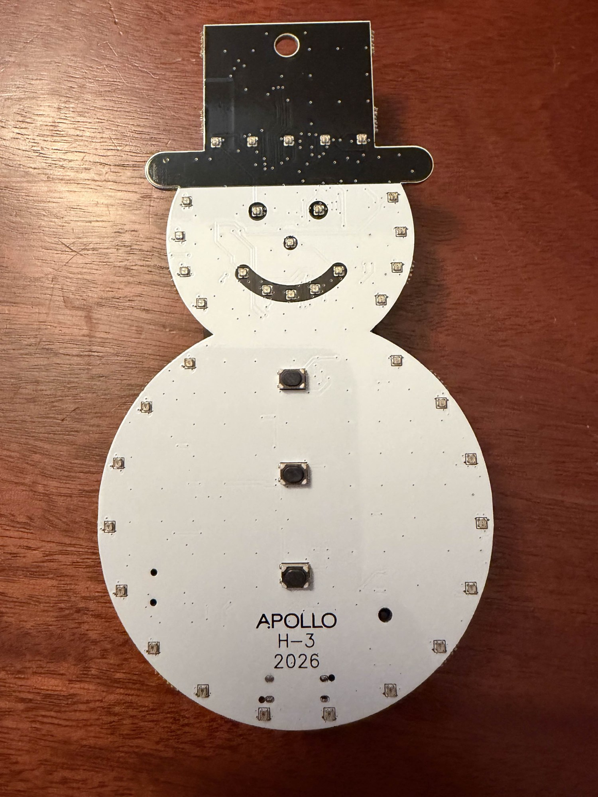

# Apollo H-3 Holiday Ornament

**Key Features of the H-3:**

- USB-C or battery powered ornament with 37 controllable RGB LEDs across five zones and a buzzer to play holiday tunes
- Individually controllable body (24 LEDs), hat (5 LEDs), mouth (5 LEDs), eyes (2 LEDs), and nose (1 LED)
- Comes preloaded with 6 holiday tunes and RGB LED patterns
- Comes flashed with basic firmware but can be flashed with our smart firmware to connect and control from Home Assistant (see [Firmware](#firmware))
- Could also be used as a bluetooth proxy or bluetooth tracker
- Features an ESP32-C6 processor with 8MB flash

**100% of profits donated to:**

- **[CASA of Lexington](https://casaoflexington.org/)** - Advocates for children in the family court system

- **[Open Home Foundation](https://www.openhomefoundation.org/)** - Apollo Automation is proud to back the Open Home Foundation. A portion of profits from every H-3 sold helps protect the values of privacy, choice, and sustainability in the smart home by supporting open source projects like Home Assistant and open connectivity standards.

## Firmware

The H-3 has two ESPHome firmwares. Install either one at any time from the browser installer at [apolloautomation.github.io/H-3](https://apolloautomation.github.io/H-3/) (Chrome or Edge on a computer).

- **Basic (No Wi-Fi)** is the firmware the ornament ships with. The buttons play the built-in songs. It has no Wi-Fi or Bluetooth.
- **Smart (Wi-Fi)** connects to Home Assistant. You can change songs and LED effects, run automations, use the Bluetooth proxy and get firmware updates.

### Install the Smart firmware

1. Take the batteries out. Hold the boot button on the back of the ornament, plug in a USB-C data cable, then let go of the button ([boot mode guide](https://wiki.apolloautomation.com/products/h3/troubleshooting/boot-mode/)).
2. In the installer, click **Connect** under **H-3 Smart (Wi-Fi) Firmware**, pick the ornament's serial port and install it.
3. When the install finishes, unplug the cable and plug it back in so the ornament restarts normally.
4. Connect the ornament to Wi-Fi in one of these ways:
   - Click **Connect** in the installer again and enter your Wi-Fi details.
   - Join the `Apollo H3 Hotspot` Wi-Fi network from a phone and choose your network.
   - Set it up from Home Assistant over Bluetooth with [Improv via BLE](https://www.home-assistant.io/integrations/improv_ble/).
5. Home Assistant discovers the ornament. Add it under **Settings > Devices & services**.

### Use it with Home Assistant

- **Updates:** the ornament checks for new firmware every 6 hours and offers it through its **Firmware Update** entity. **Firmware Channel** switches between Stable and Beta.
- **Battery:** the Smart firmware stays awake by default. Turn off **Prevent Sleep** to let it sleep between button presses; press a song button to wake it. To keep a sleeping ornament awake for an update, create a toggle helper with the entity ID `input_boolean.apollo_ota_mode` and turn it on.
- **New Wi-Fi network:** with Prevent Sleep off, the ornament goes back to sleep before its hotspot starts. Wake it with a song button, then hold the boot button for 3 to 10 seconds and let go before the song ends. That turns Prevent Sleep on, and about 90 seconds after the wake the `Apollo H3 Hotspot` network and Improv via BLE become available. Turn Prevent Sleep off again once it is back online.
- **Remove it:** delete the device under **Settings > Devices & services > ESPHome** while the ornament is awake. Factory reset it before you add it to a different Home Assistant.

### Boot button

- **Short press:** the body LEDs show the connection status. Blue means connected to Home Assistant, green means Wi-Fi only and yellow means no Wi-Fi. On the Basic firmware they always show green.
- **Hold for 3 to 10 seconds:** turns on **Prevent Sleep**, so the ornament stays awake.
- **Hold for 10 seconds or more, then release:** factory reset. This erases the Wi-Fi details and every saved setting (custom songs, volume, sleep and channel settings), then restarts. If the ornament is asleep, press a song button first to wake it. The **Factory Reset** button in Home Assistant does the same; it is in the Diagnostic section and disabled by default.

### ESPHome configuration

The ESPHome configuration lives in [Integrations/ESPHome](Integrations/ESPHome/) and is yours to modify:

- `H-3.yaml` is the Smart (Wi-Fi) firmware.
- `H-3D.yaml` is the Basic (No Wi-Fi) firmware.
- `Core.yaml` is shared by both: lights, songs, buttons and sleep.

To build your own firmware, use **Take Control** on the discovered ornament in the ESPHome Device Builder. It imports `H-3.yaml` automatically.

## Links

Discord (Support/feedback/discussion/future products): [https://link.apolloautomation.com/discord](https://link.apolloautomation.com/discord)  
Shop: [https://apolloautomation.com/products/apollo-h-3-annual-holiday-ornament-for-charity](https://apolloautomation.com/products/apollo-h-3-annual-holiday-ornament-for-charity)  
Wiki: [https://wiki.apolloautomation.com/products/h3/introduction/](https://wiki.apolloautomation.com/products/h3/introduction/)
